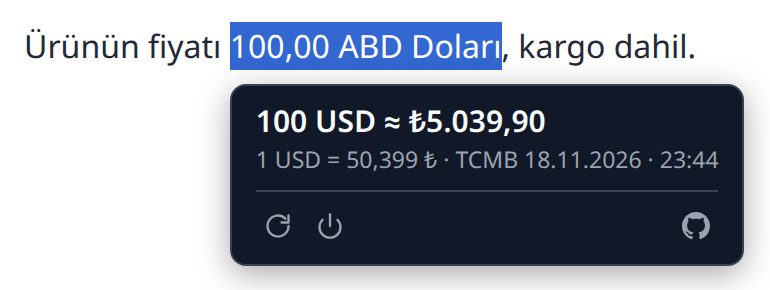
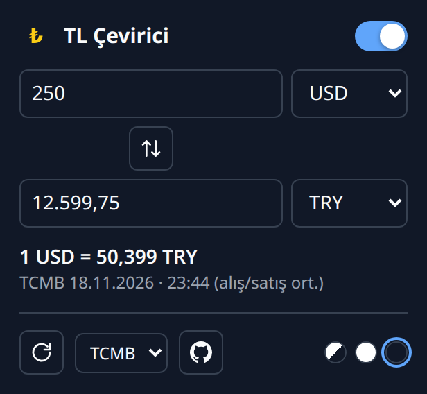

<p align="center"></p>

<h1 align="center">TL Çevirici</h1>

Chrome, Brave, Edge ve Firefox için küçük, açık kaynaklı eklenti. Sayfada bir döviz tutarını **seçtiğinde, çift tıkladığında veya kopyaladığında** yanında küçük bir balonla TL karşılığını gösterir.

Araç çubuğundaki simgeye tıklayınca açılan pencerede tutarı yazıp (`100` veya `100 dolar`) TL ve diğer para birimleri arasında da çevirebilirsin.

<p align="center">
  
  &nbsp;&nbsp;
  
</p>

- Kurlar varsayılan olarak **TCMB günlük döviz kurlarından** (`today.xml`) alınır, 1 saat önbelleğe alınır. Alış ve satış kurunun ortalaması kullanılır.
- Pencereden kaynak **ECB** (Avrupa Merkez Bankası referans kurları, [Frankfurter](https://frankfurter.dev) üzerinden) olarak değiştirilebilir. ECB bazı para birimlerini yayımlamaz (örn. SAR, KWD, AED, RUB); bunlarda balon kurun olmadığını söyler.
- Balonun ve pencerenin altındaki ikonlar: kuru hemen yenile, GitHub; balonda ayrıca balonu kapat.
- Pencerede iki tutar alanı var; hangisine yazarsan diğeri hesaplanır. Tema: otomatik, beyaz, lacivert (balon da aynı temayı kullanır). Sayfadaki balon, pencerenin üstündeki anahtarla açılıp kapatılır.
- Kurun TCMB tarihi ve alındığı saat gösterilir.
- Veri toplamaz, hiçbir yere göndermez. Tek ağ isteği seçili kur kaynağına (TCMB veya Frankfurter) gider.
- İzinler: `storage` (kur önbelleği) ve `https://www.tcmb.gov.tr/*`.

## Desteklenen biçimler

`$1,299.99` · `1.299,99 USD` · `€ 49,90` · `49.90 EUR` · `£1,000` · `1 299,50 €` · `100 dolar` · `50 dolarlık` · `20 euroya` · `29,78 ABD Doları` · `10 İsviçre Frangı` · `$1.5k` · `1,5 milyon dolar` · `25 euro` · `US$ 12.5` · `C$ 30` ...

`$ € £ ¥ US$ C$ A$` sembolleri, `USD EUR GBP CHF JPY CAD AUD ...` kodları, `dolar / euro / avro / sterlin` kelimeleri ve TCMB listesindeki tüm para birimlerinin Türkçe adları (`ABD Doları`, `Kanada Doları`, `Japon Yeni`, `Rus Rublesi`...) Türkçe ekleriyle birlikte tanınır. TL tutarları (`₺500`, `500 TL`) dönüştürülmez.

## Kurulum (Chrome, Brave, Edge, Helium ve diğer Chromium tarayıcılar)

1. Bu depoyu indir (`Code > Download ZIP`) ve klasöre çıkar.
2. `chrome://extensions` (Brave'de `brave://extensions`) adresini aç.
3. Sağ üstten **Geliştirici modu**nu aç.
4. **Paketlenmemiş uzantı yükle** deyip ZIP'ten çıkan `tl-cevirici-main` klasörünü seç: içinde `manifest.json` görünen klasör. İndirilenler gibi üst klasörü seçersen "Manifest dosyası eksik veya okunamıyor" hatası alırsın.

## Kurulum (Firefox ve türevleri: LibreWolf, Zen, Floorp…)

1. `about:debugging#/runtime/this-firefox` adresini aç.
2. **Geçici Eklenti Yükle** deyip klasördeki `manifest.json` dosyasını seç.
3. Geçici eklenti tarayıcı kapanınca silinir; kalıcı kurulum için eklentinin [AMO](https://addons.mozilla.org) üzerinden imzalanması gerekir.

Firefox 128 ve üstü gerekir. Kurulumda "tüm sitelerdeki verilere erişim" izni istenirse onayla; seçimi okuyabilmek için gerekli.

## Geliştirme

```bash
node tests/parser.test.js
node tests/tcmb.test.js
```

## Notlar

- Binlik ayırıcı olarak düz boşluk kabul edilmez (`10 100 USD` → 100 USD); bölünmez boşluk (`1 299,50 €`) kabul edilir.
- Sitedeki bir "kopyala" düğmesiyle panoya yazılan metin yakalanmaz (tarayıcı bunun için olay üretmez); metni seçmen yeterli.
- `1.299` gibi tek ayırıcılı ve ayırıcıdan sonra 3 hane olan sayılar binlik ayırıcı sayılır (1299). Fiyatlarda 3 haneli ondalık nadirdir.
- `¥` işareti JPY kabul edilir (CNY ile karışabilir).
- Ayarlar (aç/kapat, tema, kaynak) açık sayfalara anında uygulanır. Yalnızca eklenti güncellendiğinde veya yeniden yüklendiğinde Chrome/Brave önceden açık sekmelerdeki eski betiği yenileyemez; balon "sayfayı yenile (F5)" der.
- Hafta sonu ve tatillerde TCMB son yayımlanan kuru gösterir; balonda kurun tarihi yazar.

## Lisans

MIT
